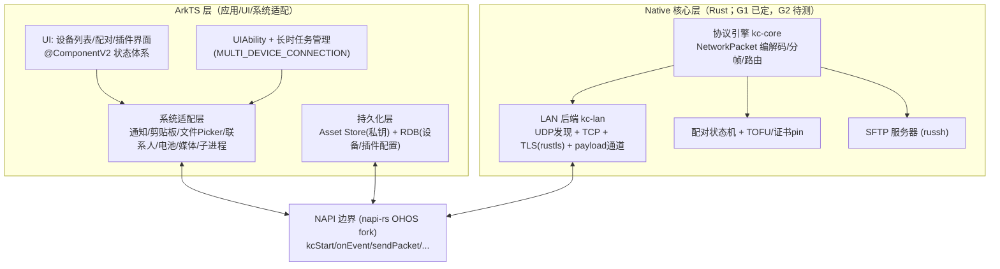

# 02 总体架构与平台能力矩阵

> 上游：`00-README.md`（文档使用协议）。事实依据：`01-reference-analysis.md`（协议与三端实现）+ 本文 §1 的平台核实记录。
> 目标形态：OpenHarmony / HarmonyOS（**API 26 = HarmonyOS 7**，向下兼容 minAPI 12）上的 KDE Connect 客户端，与桌面 kdeconnectd / Android / iOS 端协议互通。

## 1. 已核实的平台事实（截至 2026-10，均为一手来源）

| # | 事实 | 影响 | 来源 |
|---|---|---|---|
| P1 | 版本线：API 12=5.0(NEXT)、20=6.0、24=6.1.1、**26=HarmonyOS 7**(2026-06 beta)；OpenHarmony 公开线至 API 23(6.1) | compile/target API 26，minAPI 12（5.0 设备基数），不使用 API>12 的必需特性 | [华为版本总览](https://developer.huawei.com/consumer/cn/doc/harmonyos-releases/overview-allversion)；[OpenHarmony 文档站](https://docs.openharmony.cn/) |
| P2 | ArkTS `@ohos.net.socket`：`TLSSocket` 支持 mTLS（`TLSSecureOptions` 的 cert+key 非空即双向）与 `getRemoteCertificate()`；**但** `constructTLSSocketInstance(tcpSocket)`(API 12+) 只能把已连接的 `TCPSocket` 升级为 TLS **客户端**，`TLSSocketServer` 只能自己 bind/listen，**无「把已连接 socket 升级为 TLS 服务端」的入口**；`skipRemoteValidation`(API 12+) 仅作用于客户端校验服务端 | KDE 协议要求 TCP 发起方在同一连接上做 TLS **服务端**（01 §2 角色矩阵）-> ArkTS 层**不可表达**，G1 判定关闭（§8、05 §3.1） | [@ohos.net.socket API 参考](https://gitee.com/openharmony/docs/blob/master/en/application-dev/reference/apis-network-kit/js-apis-socket.md)（`constructTLSSocketInstance`、`TLSConnectOptions`、`TLSSecureOptions` 三节） |
| P2b | UDP 发往 `255.255.255.255` 在部分版本报 2301013 Permission denied（docs/kdeconnect-ref/15 问题 7 实测记录） | 发现层采用**子网定向广播**（按网卡 IP+掩码逐网卡发送），全局广播为回退，mDNS 兜底（v2）——决策 D6 | docs/kdeconnect-ref/14-鸿蒙协议适配.md §2.2；docs/kdeconnect-ref/15 问题 7 |
| P3 | 同文档明确警告：应用后台转前台后 socket 可能被断开，需重连逻辑 | 重连是必选设计（§6） | 同上 |
| P4 | 长时任务类型含 **MULTI_DEVICE_CONNECTION**（分布式业务连接）与 DATA_TRANSFER（需 10 分钟内 live-view 进度更新，否则取消）；申请需 `ohos.permission.KEEP_BACKGROUND_RUNNING`（normal/system_grant）+ module.json5 `backgroundModes`；任务存续期通知常驻，用户删除通知即终止任务；**一个 UIAbility 任务获批后整个应用所有进程不被挂起**；API21 起单 UIAbility 可同时 10 个任务 | 后台常驻方案 = MULTI_DEVICE_CONNECTION（对齐 Android 前台服务形态）；通知同时是用户可见的运行指示 | [Continuous Task 文档](https://gitee.com/openharmony/docs/blob/master/en/application-dev/task-management/continuous-task.md) |
| P5 | `@ohos.multimodalInput.inputEventClient`（输入注入）**仅系统应用可用，且当前只支持 BACK 键** | 桌面控制手机（mousereceiver/remotekeyboard 接收端、shareinputdevices）**封死**，与 iOS 同命 | [multimodalinput_input README](https://gitee.com/openharmony/multimodalinput_input) |
| P6 | Rust 官方目标 `aarch64/armv7/x86_64-unknown-linux-ohos` 为 **Tier 2（含 host tools）**；OpenHarmony TPC 官方托管 napi-rs 的 OHOS fork（`ohos_napi_rs`），另有社区 `ohos-rs` | Rust native 层有官方工具链 + 社区绑定框架 | [rustc 平台支持](https://doc.rust-lang.org/beta/rustc/platform-support/openharmony.html)；[ohos_napi_rs](https://gitcode.com/openharmony-tpc/ohos_napi_rs)；[ohos-rs](https://github.com/ohos-rs/ohos-rs) |
| P7 | HUKS（Universal Keystore Kit）：密钥生成/导入/签名/验签/加密/派生/证明，可硬件背书、非导出 | 私钥保护的演进路径（04 §3） | [HUKS Kit](https://developer.huawei.com/consumer/cn/doc/harmonyos-guides/huks-kit) |
| P8 | `ohos.permission.GET_WIFI_INFO` 为 **normal / system_grant** | 信任网络（SSID 白名单）功能可用 | [开放权限列表](https://developer.huawei.com/consumer/cn/doc/harmonyos-guides/permissions-for-all) |
| P9 | 通知：`@ohos.notificationManager` publish 需用户授权（requestEnableNotification）；系统无第三方读取其他应用通知的 API（Notification Kit 能力清单仅发布/角标/渠道/跨设备） | 通知插件只能做桌面->OH 显示方向 | [Notification Kit](https://developer.huawei.com/consumer/en/doc/harmonyos-guides/notification-kit) |
| P10 | 无障碍 Accessibility Kit 可查询节点树（读取侧公开），注入侧受 P5 限制 | 键鼠接收端的降级研究路径（后期，低优先级） | [Accessibility Kit](https://developer.huawei.com/consumer/cn/doc/harmonyos-guides/accessibility-kit) |

未定论项 -> 决策门（§8）。G1 已于 2026-10-09 依官方 API 参考关闭，其余门待 Phase 0 实测。

## 2. 总体架构

分层职责与不变式：

| 层 | 职责 | 不变式 |
|---|---|---|
| ArkTS UI | 设备三态列表（connected/visible/remembered，对齐 ios BackgroundService.m:170-190）、配对确认（显示 verification key）、插件界面 | 不直接持有 socket；一切网络动作经 NAPI |
| ArkTS 系统适配层 | 每个需要 OH Kit 的插件实现为 `PluginAdapter`：收包回调 -> 调用 Kit -> 组包回发 | 适配器无协议状态；失败必须上报引擎事件 |
| ArkTS 持久化层 | 私钥/证书材料（Asset Store）；设备档案与插件开关（RDB） | native 层无持久化：引擎启动时由 ArkTS 注入配置，会话状态仅在内存（重启可恢复，见 §5） |
| Rust kc-core | 协议引擎：包编解码（`\n` 分帧）、能力协商、插件路由、DoS 限额 | 所有字节先过限额再解析；untrusted 输入不进 unsafe |
| Rust kc-lan | UDP 发现（**子网定向广播优先**，P2b）、TCP 1716-1764、rustls（未配对 accept-any + 证书捕获；配对后 DER 相等 + CN 校验）、payload 通道 1739-1764 | TLS 角色矩阵按 01 §2；重连状态机唯一持有者 |
| Rust SFTP | russh 服务器：host key=设备密钥对，公钥认证仅限已配对设备公钥，一次性密码 28 字符 | 每次浏览重新生成密码；端口随机 1739-1764 |

C++ 的定位（仅缝隙）：AVCodec（后期 virtualmonitor 的视频解码，NDK 仅 C API）、NAPI 备选胶水。协议/网络/TLS/SFTP 一律不写 C++（依据 `05-language-analysis.md`）。

## 3. NAPI 接口契约（已冻结，详见 08）

> 本节原为草案，已由 `08-interface-contract.md` 取代：签名、事件形状、错误码、能力集、场景与 Mock 工件以 08 为唯一权威（08 §2 API、§3 事件、§4 错误码、§10 capabilities）。旧草案中的 `kcSendPacket(payload: PayloadRef)`、native/arkts 双注册路由、`trustedNetworks` 注入等描述**作废**，以 08 为准：payload 走 `sendFile` + `transferOffer/acceptTransfer`；引擎只处理 identity/pair/payload/SFTP，其余业务包全部经 `packet` 事件上抛；信任网络判定结果由 ArkTS 经 `networkChanged` 推送。跨车道协作与目录所有权见 `09-two-lane-playbook.md`。

## 4. 协议引擎实现指引

全部线规格、角色矩阵、信任模型、配对算法、防御参数**以 `01-reference-analysis.md` 为唯一权威**，本文不重复。实现约束补充：

1. **分帧**：逐字节扫描 `\n`（防越界读，对齐 Android BoundedLineReader 教训）；行长度累计超 32MiB 即断链（identity 阶段 8KiB）。
2. **JSON**：serde_json 解析为强类型 `NetworkPacket`（body 为 `Map<String, Value>`）；未知字段忽略（前向兼容）；`id` 字段收下但不校验（对齐三端——无重放保护，见 04 §3 的接受风险）。
3. **身份交换三次**：UDP 明文 -> TCP 明文（connector 带 targetDeviceId/targetProtocolVersion）-> TLS 内二次校验（v8 强制）；任何一次 deviceId/protocolVersion 不一致即断链（对齐 kde lanlinkprovider.cpp:434-445）。
4. **时钟**：配对时间戳 ±1800s；系统时钟跳变导致配对失败时 UI 提示「设备时钟不同步」（文案对齐桌面 kde pairinghandler.cpp:61）。
5. **能力协商**：`updateDeviceInfo` 仅在两端能力集均非空时更新（对齐 and Device.kt:394-412 的防抖语义）；发送前校验对端 incoming 包含目标 type。
6. **payload 传输**：单文件 header 包 + 独立 TLS 连接按 payloadSize 流式收发；`numberOfFiles/totalPayloadSize` 与进度包 `kdeconnect.share.request.update` 对齐。
7. **协议版本**：只实现 v8；identity 声明 8；收到 <8 的 identity 记录并拒绝（比桌面「仅对已配对降级拒绝」更严格，桌面对未配对新设备是警告后接受——**差异点**：我们明确不支持 v7 老端，写入互操作矩阵 §9）。

## 5. 状态与持久化

| 数据 | 存储 | 说明 |
|---|---|---|
| 本机私钥（PKCS#8 DER，P-256） | Asset Store Kit（单条 <= 1024B，04 §3） | 证书重生成 -> 全部解配对（对齐桌面语义） |
| 本机证书（PEM，公开数据） | 应用沙箱 filesDir | 启动时校验有效期与 CN==deviceId，异常则整体重生成 |
| 已配对设备档案（id/证书 PEM/名称/protocolVersion） | RDB（经 ArkTS） | 引擎启动注入；配对成功/解配对时 ArkTS 写回 |
| 插件开关（per-device） | RDB | 键 `<pluginKey>Enabled`，缺省见能力矩阵 |
| 信任网络 SSID / 自定义 IP | Preferences | GET_WIFI_INFO 读取当前 SSID 做判定 |
| 引擎会话状态（links/配对中状态） | 仅内存 | 重启即重发现，对齐 iOS 的激进重启模式 |

## 6. 后台与生命周期

1. UIAbility `onForeground`：启动引擎 + 申请 MULTI_DEVICE_CONNECTION 长时任务（通知文案「KDE Connect 正在保持设备连接」，点击拉起主界面——即 Android 前台服务通知的等价物）。
2. `onBackground`：**不**停止发现（与 iOS 相反——OH 有长时任务授权），但监听 `continuousTaskCancel` 回调：用户删通知/系统取消 -> 降级为 iOS 模式（停 UDP 广播，保留 TCP 监听，回前台再全量刷新）。
3. 进程被杀（无第三方 BOOT_COMPLETED）：需用户手动启动。UI 在「设置」页明示此限制（对齐 iOS 现状，诚实披露）。
4. 网络变化：`@ohos.net.connection` 注册回调 -> 引擎 `onNetworkChange` -> 重启全部 linkProvider（对齐 ios NetworkChangeMonitor 的去抖模式）+ 重发 UDP 广播。
5. socket 断开自愈：读线程退出 -> 300ms 宽限等新 socket（对齐 and LanLink.java:78-86）-> 不可达事件。

## 7. 插件能力矩阵（v1 范围与门控）

方向约定：**TX** = OH 发送到桌面（OH 控制桌面）；**RX** = OH 接收桌面。

| 插件（包类型） | 方向 | Android 机制 | iOS | OH 可行性 | 置信 | 门 |
|---|---|---|---|---|---|---|
| ping | 双 | - | 有 | ✅ 纯协议 | 高 | - |
| mousepad/remotekeyboard/presenter（OH 作触控板键盘） | TX | IME 捕获 | UIKeyInput | ✅ ArkTS 自绘输入视图捕获（IME TextInput） | 高 | - |
| mpris TX（OH 控桌面媒体）、remotesystemvolume TX | TX | - | 部分 | ✅ 纯协议发送 | 高 | - |
| runcommand（OH 触发桌面命令） | TX | - | 有 | ✅ | 高 | - |
| findmyphone（桌面寻 OH 设备） | RX | 通知+响铃 | app 内声音 | ✅ notificationManager + 声音/振动 | 高 | G7 |
| share（桌面发文件到 OH） | RX | 公共下载目录 | Files/相册 | ✅ 沙箱目录 + 用户可选保存到相册/文件（picker 写入） | 高 | - |
| share（OH 发文件到桌面） | TX | SAF/picker | fileImporter | ✅ DocumentViewPicker + payload 上传 | 高 | G5(fd桥) |
| clipboard（桌面->OH 任意时；OH->桌面 用户触发） | 双 | 全局 | 前台 | ✅ 受限：读剪贴板需 `READ_PASTEBOARD`（受限 ACL 权限）-> v1 用 `PasteButton` 安全控件「点一次发一次」；写剪贴板不受限 | 高 | - |
| notifications（桌面->OH 显示） | RX | 全量+回复 | 无 | ✅ 收包 + 本地通知显示（带回复 actionButton 回传 notification.reply） | 中 | G7 |
| battery（OH 电量报桌面） | TX | 广播 | UIDevice | ⚠ `@ohos.batteryInfo` 疑似 systemapi | 低 | G6 |
| connectivity_report | TX | - | 无 | ✅ @ohos.net.connection | 中高 | - |
| runcommand 接收端（桌面触发 OH 命令） | RX | 无本地执行 | 无 | ✅ `childProcess`（沙箱内） | 中 | - |
| sftp（桌面浏览 OH 文件） | RX | MINA SSHD | 无 | ✅ russh；目录暴露=沙箱+用户授权持久 URI | 中 | G5 |
| contacts | TX | READ_CONTACTS | 无 | ✅ Contact Kit（隐私敏感，v1 末评估） | 中 | - |
| mpris RX / systemvolume RX（桌面控 OH） | RX | MediaSessionManager+通知监听 | 无 | ⚠ AVSession 跨应用控制器疑似 system 权限 | 低 | G4 |
| notifications 反向（OH 通知同步到桌面） | TX | NotificationListenerService | 无 | ❌ 无公开监听 API | 高(否定) | - |
| mousereceiver/remotekeyboard RX、shareinputdevices RX | RX | AccessibilityService | 无 | ❌ inputEventClient 系统应用专用（P5） | 高(否定) | - |
| lockdevice RX（桌面锁 OH） | RX | - | 无 | ❌ screenLock systemapi | 中(否定) | - |
| sms/telephony | 双 | 电话/短信 API | 无 | ❌ telephony systemapi（发送短信 Kit 待查） | 低 | - |
| virtualmonitor（OH 作桌面扩展屏） | RX | - | 无 | ⏳ 后期：屏幕协商 + AVCodec 解码 + mousepad 回传 | 低 | - |
| bigscreen/digitizer RX 等 | RX | - | - | ❌ 输入注入受限 | 高(否定) | - |

**范围结论**（对齐 iOS 的受限平台哲学，但比 iOS 强）：v1 = 全部 TX 类 + share/findmyphone/notifications RX + sftp。RX 输入类与媒体类按门控结果裁剪。

## 8. 决策门（每个门 = 一个可执行 spike，判定记录进风险登记册）

| 门 | 问题 | 通过判定 | 失败分支 |
|---|---|---|---|
| **G1（已关闭）** | ArkTS TLSSocket 能否承载主链路 | **不能**（2026-10-09 判定，依据 P2）：角色反转不可表达 | 引擎 TLS 走 rustls（05 §6 主路径）；Phase 0 不再需要 S1 探针，改为 S1' 验证 rustls 双角色握手对桌面 |
| **G2** | Rust 工具链：`aarch64-unknown-linux-ohos` + napi-rs OHOS fork + **ring 交叉编译**在 API 26 SDK 下可构建/调试；`panic = "unwind"` 在 OHOS 目标下 `catch_unwind` 生效 | demo HAP 跑通 NAPI 双向调用 + rustls(ring) 握手 + panic 捕获不崩宿主 | 回退 C++ 引擎（OpenSSL 交叉编译，05 §6） |
| **G3** | MULTI_DEVICE_CONNECTION 长时任务下空闲 TCP 监听 + UDP 收包 8h+ 存活；用户删通知后行为 | 真机后台 8h 观察报告 | 降级 iOS 模式（前台连接 + 传输期短任务） |
| **G4** | `avSessionManager.createController` 对他应用会话的权限 | 能列出并下发 play/pause | 砍掉 mpris RX/systemvolume RX |
| **G5** | 文件访问桥：ArkTS 持久 URI 授权 -> native fd（`fs.openSync` fd 传递 vs native 直开沙箱路径）；**前置坑：picker 选中的外部文件不能直接读，必须先复制进沙箱**（docs/kdeconnect-ref/15 问题 6） | 双向传 1GB 文件基准 | SFTP 暴露范围缩至沙箱目录 |
| **G6** | `@ohos.batteryInfo` 是否 systemapi；有无替代（设备信息 Kit） | 能读 soc+充电态 | 砍掉 battery 插件，UI 显式标注 |
| **G7** | 通知：requestEnableNotification 授权流 + 后台 publish 限制 + actionButton 回传 | 后台收到桌面通知能弹出且可回复 | notifications RX 降级为应用内横幅 |

## 9. 互操作验收矩阵

| 对端 | 版本 | 预期 |
|---|---|---|
| kdeconnect-kde master | v8 | ✅ 全部 v1 功能（发现/配对+SAS/ping/share 双向/剪贴板/媒体控制/音量/runcommand/findmyphone/sftp/通知显示） |
| kdeconnect-android master | v8 | ✅ 同上（对端 TX 通知/短信在 OH 侧按能力矩阵裁剪显示） |
| KDE Connect iOS 0.5.6 | v8 | ✅ 核心（ping/share/clipboard/battery(若 G6)/mousepad TX） |
| v7 及更老端 | <=7 | ❌ 明确拒绝（我们只实现 v8；桌面端对 v7 是警告后接受，差异已记录） |
