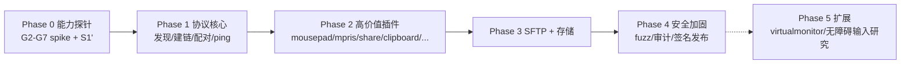

# 03 开发规划与 Agent 指挥协议

> 上游：`00-README.md`。本文件是**所有后续 Agent 任务的执行宪法**：阶段门禁、验收协议、任务卡格式、红线。架构依据 `02-architecture.md`，安全红线依据 `04-security.md`。

## 1. 阶段总览



原则：**决策门未全部关闭不得进入下一阶段**；每阶段结束更新风险登记册（§8）与本文档的完成标记。

## 2. Phase 0 —— 能力探针（预计 7 个独立 spike，可并行）

每个 spike = 一个独立 HAP（DevEco 工程模板 + 最小代码），产出物 = 探针报告（Markdown：目标/步骤/实测输出/判定/证据截图或 hdc 日志）。判定标准见 02 §8。

| Spike | 内容 | 前置 |
|---|---|---|
| S1' (原 G1，已判定) | 不再探测 ArkTS TLSSocket（02 P2 已证明不可表达）；改为 host 侧最小 rustls 演示：同一 TcpStream 上双角色（TCP 发起方=TLS server、监听方=TLS client）+ 未配对接受任意自签证书并捕获 + 已配对 DER pin，对本机 kdeconnectd 或 Go 对端握手成功 | 不依赖 OH 环境，M0 后可立即做 |
| S2 (G2) | Rust：rustup target aarch64-unknown-linux-ohos + ohos_napi_rs 构建最小 NAPI 模块；panic 捕获；hdc 安装运行。**2026-10-12 状态：G2 尚无任何执行证据（此前"已验证"为误记）；前置：装 rustup（本机无，见 09 §3）→ 加 ohos target → DevEco SDK** | rustup/DevEco 环境就绪 |
| S3 (G3) | 长时任务 MULTI_DEVICE_CONNECTION + 空闲 socket 8h 存活实测；删通知行为 | 真机或模拟器 |
| S4 (G4) | avSessionManager 控他应用会话 | 真机（需装一个媒体应用） |
| S5 (G5) | DocumentViewPicker 持久 URI -> fd -> native 读写 1GB 基准 | S2 通过后合并进 S2 工程 |
| S6 (G6) | batteryInfo 可用性 + 替代路径 | - |
| S7 (G7) | 通知授权流 + 后台 publish + actionButton | - |

> 环境注意（本机规则）：DevEco Studio / SDK / 命令行工具安装、模拟器镜像下载等需要安装软件的步骤一律停下交用户执行；hdc 对真机的操作先 `toolhelp show hdc --brief`。无真机时 S3/S4/S7 标记「模拟器限定」并保留真机复验任务。

## 3. Phase 1 —— 协议核心（引擎 + 最小 UI）

范围：Rust kc-core/kc-lan（或 G2 失败分支的 C++ 等价物）：UDP 发现、TCP 建链（角色矩阵）、rustls TOFU/pin、v8 三次身份交换、配对状态机 + SAS、能力协商、ping 收发、设备三态列表 UI、配对对话框（显示 verification key）。

DoD（全部满足才可验收）：

1. `cargo test` 全绿：线格式编解码（与 01 §1 字节级对照，含 `\n` 终止、payloadSize=-1）、角色矩阵、配对状态机（06 §2.4 转移表逐行一例）、verification key（06 §2.5 已知答案向量 `A82E8F8A`，并断言 != 错误顺序值 `71A26CF5`）。
2. **互操作实测**：与 Go 协议对端（§7 L2）完成：互相发现 -> 建链 -> 配对（含 SAS 比对）-> ping 往返 -> 异常路径（错误 timestamp、错误 deviceId、超限包）。
3. 真机（或模拟器）：与本机 CachyOS 上的 kdeconnectd 完成真实配对 + ping（需用户安装 `kdeconnect`，命令交用户执行）。
4. 引擎限额生效验证：构造 9KB identity / 33MiB 行 / 43 并发未配对连接，全部被拒且不崩溃。
5. `04-security.md` §8 红线逐条自查通过。

## 4. Phase 2 —— 高价值插件（TX 全家 + RX 核心）

范围（按能力矩阵 ✅ 行）：mousepad（触控板/键盘 UI + IME 捕获 + specialKey 全表）、presenter、mpris TX、remotesystemvolume TX、runcommand TX、clipboard（前台语义）、share 双向（含 payload 通道 + 进度）、findmyphone、notifications RX（G7 结果裁剪）、connectivity_report、battery（G6 结果裁剪）。

DoD：

1. 每插件：schema 驱动的包字段单测（读 `meta/schemas/kdeconnect.<type>.json` 生成用例：必填缺失/类型错误/超长字段全部拒绝或降级）。
2. 桌面互操作场景清单逐项过（发送文件 10MB/1GB、进度通知、剪贴板往返、寻机响铃、桌面通知显示+回复）。
3. 后台行为：S3 结果下的长时任务挂 4h，事件（ping/share）仍可达。

## 5. Phase 3 —— SFTP + 深存储

范围：russh SFTP 服务器（认证模型对齐 01 §6 表：host key=设备密钥对、公钥白名单=已配对设备、一次性密码 28 字符、端口 1739-1764）、目录暴露（沙箱 + G5 持久 URI）、桌面 `kdeconnect-sftp` 挂载实测、multiPaths/pathNames、`kdeconnect.sftp.request{startBrowsing}` 触发流。

DoD：桌面挂载成功（sshfs 路径）；多路径枚举正确；错误场景（无授权目录）回 `errorMessage` 包；密码恒时比较有单测；fuzz 前置（见 Phase 4 但 SFTP 协议解析器先入 fuzz 集）。

## 6. Phase 4 —— 安全加固与发布

- Fuzz：行分帧 parser、JSON 反序列化、SFTP 服务器（russh + sftp 子系统封装层）、证书 DER 解析、pair timestamp 边界；coverage 记录，崩溃零容忍。
- `cargo deny`（许可/重复依赖）+ `cargo audit`（CVE）入 CI；ohpm 依赖锁定。
- 渗透用例清单执行（04 §7）。
- 发布签名（AGC 流程交用户）、minAPI 兼容矩阵回归（12 与 26 双档）。

## 7. 工程结构（规划，落位 `/home/fk/WorkSpace1/kdeconn/oh-kdeconnect/`；车道所有权详见 09 §2）

```
oh-kdeconnect/
  contract/           kcbridge.d.ts / errors.v1.json / capabilities.v1.json / scenarios/ / CCR-*.md  （双车道共管，08 §9）
  docs -> ../docs/kdeconnect-oh        (符号链接或直接复用)
  app/                                 (DevEco 工程, hvigor；ArkTS 车道)
    entry/src/main/ets/
      logic/         Kit-free 纯逻辑层（09 §5，bun 同构测试）
      ui/ store/ adapters/ bridge/ persist/ lifecycle/
    entry/libs/{arm64-v8a,x86_64}/     libkcbridge.so（Rust 车道 build-ohos.sh 写入）
    entry/src/main/cpp/types/libkcbridge/   index.d.ts（Rust 车道拷自 contract/）
  engine/                             (Rust 车道)
    crates/kc-core    协议引擎(纯逻辑, 无 IO)
    crates/kc-lan     socket/rustls/payload 通道
    crates/kc-sftp    russh 服务器
    crates/kc-engine  编排（设备表/配对/传输），host 可驱动（08 §7）
    crates/kc-bridge  napi-rs OHOS 绑定（薄壳）
    fuzz/             cargo-fuzz 目标
  tools/protocol-peer/               (Go 互操作对端, 09 §7)
  tools/arkts-logic-test.sh           (ArkTS 车道, bun)
  scripts/build-ohos.sh / README.md
```

**测试层级 L1-L4（贯穿所有阶段）**：

| 层 | 载体 | 内容 |
|---|---|---|
| L1 | `cargo test`（host） | 线格式/状态机/算法已知答案/限额/路由（无设备依赖，CI 必跑） |
| L2 | Go 对端 `tools/protocol-peer` | 依据 01 + meta schemas 实现的桌面端模拟器：可编排「广播->建链->配对->任意包收发->payload 传输->异常注入」。**Python 版作废**（标准库 ssl 无法在服务端角色放行自签客户端证书，本机实测失败；Go `tls.Server`+`RequireAnyClientCert` 一次跑通，09 §7）。也是 S1' 对端 |
| L3 | 真机/模拟器 E2E | hdc + 桌面 kdeconnectd 场景清单 |
| L4 | cargo-fuzz + ASAN | 恶意输入（超长/畸形/非法证书/半包） |

## 8. 风险登记册（初始；每阶段末更新）

| ID | 风险 | 概率 | 影响 | 缓解 | 状态 |
|---|---|---|---|---|---|
| R1 | ArkTS TLSSocket 无法表达 TLS 角色反转（G1） | 已发生 | 架构级 | 已由 rustls 主路径吸收；ArkTS 引擎方案作废（05 §3.1） | 关 |
| R2 | napi-rs OHOS fork / ring 与 API26 SDK 兼容缺口（G2 失败） | 中 | 架构级 | 回退 C++ 引擎（05 §6 决策树）；fork 两个（TPC/ohos-rs）双保险 | 开 |
| R3 | 长时任务空闲被判违规/取消（G3） | 中 | 体验 | 降级 iOS 前台模式；连接按需重建 | 开 |
| R4 | 通知后台受限（G7） | 中 | 功能 | 应用内横幅降级 | 开 |
| R5 | batteryInfo systemapi（G6） | 高 | 小功能 | 砍功能不砍架构 | 开 |
| R6 | fd 桥性能损耗（G5） | 低 | 传输速率 | 沙箱路径直开兜底 | 开 |
| R7 | Rust 学习曲线（人为因素） | 中 | 进度 | kc-core 小而模式化；Go 不进本架构（实测无 OHOS 目标，05 §1.2） | 开 |
| R8 | 上游协议演进（v9 等） | 低 | 兼容 | 引擎层版本常量隔离；meta 仓库 schema 为对照源 | 开 |
| R9 | iOS 教训：无协议测试 | 已消除 | - | L1/L2 为 Phase 1 DoD 硬条件 | 关 |

## 9. Agent 指挥协议（任务卡宪法）

**任务卡模板**（任何 Agent 任务必须以此发起，缺项即无效）：

```
[任务卡]
目标: <一句话>
引用: <本文档章节 + 01/02/04/05 相关节号 + 上游 file:line>
范围: <改哪些目录; 明确不改什么>
DoD: <可执行的验收命令与期望输出>
验证: <L1-L4 哪几层; 真机需要性>
红线确认: <勾选 04 §8 与下方全局红线>
```

**全局红线（每个任务开始前自读）**：

1. 上游四棵树（`kdeconnect-*-master`、`meta`）**只读**；一切产出落在 `oh-kdeconnect/` 与 `docs/kdeconnect-oh/`。**双代理模式下只写本车道所有权目录（09 §2 表），`contract/` 只能走 CCR**；违反 = 任务失败（09 §9 红线 11-13）。
2. 不向任何 KDE 仓库 push / 开 MR（工作区 AGENTS.md 贡献政策；KDE 明确拒绝无人监督的 agent 贡献）。
3. 任何 sudo / 系统安装命令：停止并交用户执行（本机最高优先级规则）。
4. 文档驱动：行为变更先改 01/02/03/04 相应章节再改代码；每任务结束同步风险登记册。
5. 决策门未关不得实现依赖它的功能；门结果记录在 02 §8 + §8 登记册。
6. 验证协议：无 L1/L2 证据的协议代码不合并；「能跑」不等于「验收」。
7. 安全红线（04 §8）违反 = 任务立即失败，无豁免路径。
8. 会话节奏：跑完一个模块进入下一模块前，向用户汇报并等待确认（除非用户已明确说连续执行）。
9. 编码任务（涉及 Rust/NAPI/ArkTS 任一层）开工前必读 `06-coding-standards.md` 对应层小节；交付时评审者必须过 `06 §8` 十二项清单，未过即失败。
10. 模块实现顺序、骨架三件套、联调场景与缺陷处理一律按 `07-development-walkthrough.md` 执行：跳过骨架评审直接铺码、或缺陷修复未走 `07 §7` 根因四步，均视为补丁式开发，任务失败。

**升级路径**：门失败/文档冲突/能力与假设不符 -> 停下，写「冲突报告」（假设 vs 实测），交用户裁决；不得自行放宽安全参数或砍验收标准。
