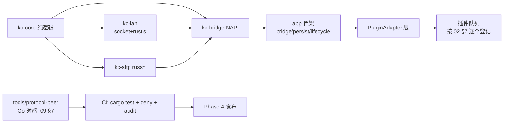

# 07 全项目开发导引（从空仓库到发布维护）

> `03-development-plan.md` 定**阶段门与 DoD**（什么时候能过），本文定**步骤与顺序**（怎么一步步做完）。二者配合：每个 Phase 展开为本文的一组里程碑（M 序列），任务卡全部从本文的模块条目发起。
> 核心方法论：**骨架先行、契约冻结、按依赖顺序集成、缺陷走根因协议**——对抗补丁式开发的执行层。

## 1. 总依赖图与构建顺序



顺序原则：**任何模块开工前，其全部上游必须已过自己的骨架评审**（§3）。protocol-peer 可与 kc-core 并行（它只依赖 01 的协议事实）。

## 2. 里程碑 M0 —— 仓库与基建（Phase 0 前置，1 个任务卡）

| 项 | 内容 | 验收 |
|---|---|---|
| M0.1 | `oh-kdeconnect/` 目录 + Rust workspace（4 crate 空骨架 + `rust-toolchain.toml` 锁版本） | `cargo build` 零错误 |
| M0.2 | hvigor 工程骨架（空 UIAbility + `app/src/main/cpp/` 桥位） | DevEco 能出空白 HAP（交用户装 SDK 后验证） |
| M0.3 | `tools/protocol-peer/`：Go 工程（09 §7），先实现 `identity` 构造与 UDP 广播收发（双角色 TLS 骨架一并落） | 本机 localhost 双实例完成「广播->建链->TLS 双向握手」（无需 root 抓包；Python 版作废，09 §7 实测依据） |
| M0.4 | CI 脚本：`cargo test && cargo deny check && cargo audit`（本地先跑通，CI 平台后补） | 全绿输出留档 |
| M0.5 | 每个 crate `lib.rs` 写入初始不变式清单（06 §2.1 示例、06 §7） | 评审一次 |

M0 完成后：Phase 0 的 S1' 与 G2-G7 探针卡按 03 §2 发起（S1' 只需 host 环境，可立即开始；需 OH 环境/真机的项标注等待用户）。

> 双代理模式注记：模块顺序表（§4）按「引擎 -> 桥 -> app -> 插件」串行表述，是**逻辑依赖序**；双车道并行执行时按 09 §4 时间线与 09 §6/§8 任务队列（M/A 序列）拆分归属，表内 4-7 步由两车道在各关卡汇合完成。

## 3. 骨架先行协议（每个模块的三件套）

任何模块（crate 内的子模块、adapter、UI 页面）实现前先交付「三件套」并评审：

1. **公开面**：`pub` 函数签名/类型定义（含文档注释：契约引用 01 章节 + 错误分级）。
2. **不变式**：3-8 条陈述（写进 `lib.rs` 头部或 adapter 类注释）。
3. **测试桩**：公开面全部函数的 `#[test]` 空壳 + 预期断言的测试名清单（失败断言可 `todo` 但必须列名）。

评审通过 = 契约冻结：后续变更走 P2（先改契约再改实现）。**禁止跳过骨架直接写实现体**——这是本项目防「补丁堆」的第一道闸。

## 4. 模块实现顺序详解（Phase 1 展开）

| 序 | 模块 | 输入依赖 | 交付物 | 集成点（联调触发） |
|---|---|---|---|---|
| 1 | `kc-core/packet.rs` | 01 §1 | 分帧+序列化+限额 | L1 + protocol-peer 收包比对 |
| 2 | `kc-core/identity.rs` | 01 §2/§4 | identity 构造/校验/过滤 | peer 互发 identity |
| 3 | `kc-core/pairing.rs` | 01 §3 | 状态机 + SAS + 时间戳 | peer 发 pair 序列（正/负/超时） |
| 4 | `kc-lan`（TLS 角色 + 重连） | 2/3 + S1' 与 G2 结果 | UDP 发现 + TCP + rustls TOFU/pin（06 §2.7 verifier 骨架） | 与 peer 完成未配对握手+配对 |
| 5 | `kc-bridge` | 4 | NAPI 导出 + 事件通道 | 真机 HAP 上事件可见 |
| 6 | `app` 三层（bridge/persist/lifecycle） | 5 | 设备列表 UI + 配对对话框 + 长时任务 | 真机对桌面 kdeconnectd 配对（SAS 双端一致） |
| 7 | ping 插件（首个端到端） | 全部 | Cookbook 7 步全流程跑一遍 | 桌面 ping 往返 |

第 7 项是**校准步骤**：故意用一个最小插件把「引擎->桥->adapter->UI->文档」全链路走通，暴露所有层间缝隙，之后插件队列才批量展开。

## 5. 插件队列（Phase 2/3 展开）

排序依据 02 §7 矩阵：无门控 ✅ 行优先，按用户价值降序：

1. mousepad（旗舰，含 specialKey 全表与 IME 捕获视图）
2. share 双向（payload 通道上线，触发 G5）
3. mpris TX / remotesystemvolume TX / runcommand TX / presenter
4. clipboard（前台语义）+ findmyphone + notifications RX（G7 结果）
5. connectivity_report + battery（G6 结果）
6. sftp（独立小 Phase 3，kc-sftp + fd 桥 + 桌面挂载实测）

每插件严格走 06 §6 Cookbook；队列状态记在 03 §风险登记册旁的「插件进度表」（M0 时建表，每行：插件/门控/骨架评审/实现/测试/文档 六格）。

## 6. 联调剧本（L1 -> L2 -> L3 的场景序列）

每层退出条件为「下方全部场景通过」；场景失败走 §7 缺陷协议。

| 层 | 场景 | 断言 |
|---|---|---|
| L1 | SAS 已知答案、identity 过滤、pair 超时/时钟漂移、分帧半包、32MiB 超限 | 每场景 >=1 通过 + >=1 违例拒绝 |
| L2 | 发现->建链->配对（含双方 SAS 相等）->ping 往返->单/多文件 payload->断链重连 | peer 双方状态一致；字节级 payload 哈希相等 |
| L2(负) | 伪 identity 刷屏（>限速）、43 并发未配对、畸形 JSON、half-open 连接泄漏 | 全部被拒；fd 计数回落 |
| L3(真机) | 与桌面 kdeconnectd：配对 SAS、ping、传文件、剪贴板、桌面通知显示、后台 4h 存活（G3） | UI 可见 + hdc 日志留档 |

## 7. 缺陷处理协议（反补丁工作流）

任何 bug（联调发现/审查发现/用户报告）必须走四步，缺一不可：

```
[BUG 报告] 复现步骤 + 期望(引用文档契约章节) + 实际
   -> [归因] 指出违反的不变式/契约（06 各层小节或 lib.rs 清单）；
      禁止「现象层归因」（"加了判空就好了"不是归因）
   -> [修复设计] mini 任务卡：改哪一层、动哪些测试（含回归用例）
   -> [关闭] 回归测试过 + 文档同步(如契约受影响) + 登记册记录
```

三条硬规则：

1. 修复不允许新增「仅覆盖该 bug 的特判」（P1）；若必须特判，说明为什么这不是不变式破口。
2. 同类第二次出现的 bug 升级为「不变式缺失」问题：补不变式 + 全量回归，不允许再打第二个补丁。
3. 跨层 bug（如桥与引擎对错误码理解不一致）必须修**契约表**（02 §3 / 06 §3.4），不允许两端各自迁就。

## 8. 上游演进协议（协议 v9 等变更到来时）

1. `meta` 仓库 diff 出新 schema/字段 -> 更新 01 对应表（事实层）。
2. 评估影响面：仅新增字段 -> `TryFrom<Value>` 的未知字段容忍策略自动兼容，补测试即可；语义变更（如 SAS 算法）-> 走 06 §1 P2 契约先行 -> 引擎版本常量（`limits.rs`）与协商逻辑更新 -> L1/L2 全回归。
3. 桌面端实测回归一次（L3 场景表）后发布。

## 9. 项目完成定义（映射 03 Phase 4 出口）

- 功能：02 §7 v1 范围全部插件过 L1-L3；门控 ❌ 行在 UI 有明确「不可用」说明。
- 质量：fuzz 目标零 crash、ASAN 干净、cargo deny/audit 零未处理项。
- 安全：04 §8 红线自查表归档；渗透用例 T1-T7 全绿。
- 交付：签名 HAP + `README.md`（中文，含限制说明：无开机自启、无桌面控手机、协议 v8-only）+ 文档套件终版。

维护期：缺陷一律走 §7；上游演进走 §8；每次发布前 L3 场景表全量回放。
