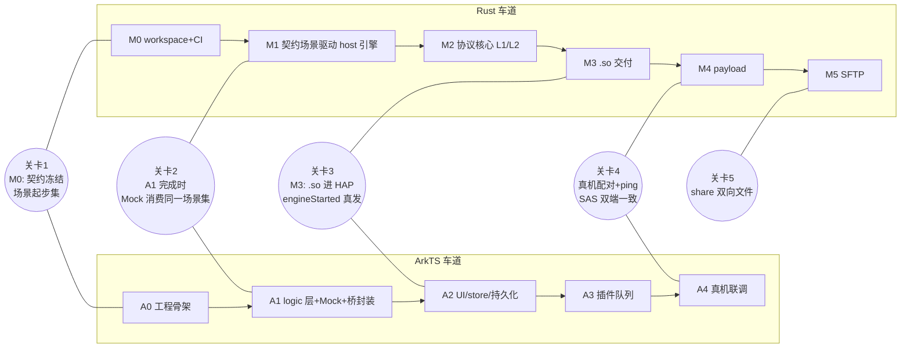

# 09 双车道执行手册（ArkTS Agent + Rust Agent 并行到集成）

> 上游：`00-README.md`；接口唯一依据：`08-interface-contract.md`（冻结契约）。本文回答：两个 Agent 分管 ArkTS 与 Rust/C++，如何并行、在哪同步、怎么保证质量。
> 结论先行：**此前文档不足以支撑双 Agent 轻松完成**——接口是草案不是可校验契约、无车道归属、两侧无法在对方缺席时开发测试、质量闸门没有落到命令。本文 + 08 补齐后可以：两车道各自有唯一入口手册、独立可测（Mock/场景同构）、在 5 个集成关卡汇合、每步有可执行验证命令。

## 1. 评估：为什么会失败（本轮修正的原因）

| 缺口 | 后果（双 Agent 场景） | 补救 |
|---|---|---|
| 接口仅伪代码（02 §3） | 两车道对 bodyJson/事件形状/错误码各自理解，集成即翻车 | 08 冻结契约 + 黄金场景双端断言 |
| 路由规则两处矛盾（02 §3 vs 06 §5） | Rust 不知道该不该处理业务包 | 08 §1/§10：引擎只做 identity/pair/payload/SFTP，其余全上抛 |
| 无车道归属 | 双方都写 `build-ohos.sh` 或都没写；.so 落位无人管 | §2 所有权表 |
| ArkTS 无独立测试路径 | Rust 没交付前 ArkTS 车道空转；`hvigorw test`（Local Test）**官方注明暂不支持 Linux** | 逻辑层 bun 同构测试（已实测可行）+ MockKcEngine |
| 能力集未冻结 | 宣告类型拼错 -> 静默不互通 | 08 §10 capabilities.v1.json |
| 模板是设计示意（未编译） | Agent 照抄编不过 | 06 头部声明 + M0 首任务=编译模板并记偏差 |

## 2. 目录所有权（谁写什么，冲突即违规）

| 路径 | 车道 | 说明 |
|---|---|---|
| `oh-kdeconnect/engine/**`（kc-core/kc-lan/kc-sftp/kc-engine/kc-bridge） | Rust | 06 §2.1 结构 + 08 §7 形态约束 |
| `oh-kdeconnect/tools/protocol-peer/**`（Go，见 §7） | Rust | 引擎的独立协议对端 |
| `oh-kdeconnect/engine/fuzz/**`、`scripts/build-ohos.sh` | Rust | build 负责产出 `.so` 并落位 |
| `oh-kdeconnect/app/**`（entry 模块、ets、resources、module.json5） | ArkTS | UI/适配/持久化/lifecycle |
| `oh-kdeconnect/app/entry/src/main/ets/logic/**` | ArkTS | **Kit-free 纯逻辑层**（§5 bun 测试前提） |
| `oh-kdeconnect/app/entry/libs/arm64-v8a/`、`x86_64/`（放 `libkcbridge.so`） | Rust 产出 | 生成物目录，gitignore，由 build-ohos.sh 写入 |
| `oh-kdeconnect/app/entry/src/main/cpp/types/libkcbridge/`（`index.d.ts` + `package.json`） | Rust 产出 | 拷自 contract/kcbridge.d.ts |
| `oh-kdeconnect/app/entry/oh-package.json5` 的依赖声明行 | ArkTS | `libkcbridge.so` 的 types 依赖（DevEco 惯例，08 §9 工件落位） |
| `oh-kdeconnect/contract/**`（d.ts/errors/capabilities/scenarios/CCR） | **共管** | 只能走 CCR 流程修改（08 §9），任一车道单方面改 = 违规 |
| `docs/kdeconnect-oh/**` | 用户/主控 | 车道发现文档错误 -> 提请修正，不自行改 |
| 上游四棵树 | 无人 | 只读（03 §9 红线 1） |

## 3. 两车道就绪卡（开工前读什么、装什么）

**共同**：`00` -> `08`（全文）-> 本手册。红线自读 03 §9（追加项见 §9）。

**Rust Agent**：读 `01`（全文，协议事实）、`06` §2/§3、`04` §4-§7。环境：**rustup（2026-10-12 核查：本机仅有 Arch 打包 rustc 1.99，rustup 未安装、~/.cargo 与 ~/.rustup 均不存在——安装 rustup 是 G2 前置第一步，需用户同意下载）**、`rustup target add aarch64-unknown-linux-ohos x86_64-unknown-linux-ohos`、OHOS SDK（native/llvm + sysroot，路径占位待用户安装）、clang 包装脚本与 cargo linker 配置（[rustc OHOS 官方配置](https://doc.rust-lang.org/beta/rustc/platform-support/openharmony.html)）、`cargo install cargo-deny cargo-audit cargo-fuzz cargo-llvm-cov` 与 `ohrs`（联网安装需用户同意，装完才可跑对应闸门）。宿主侧无设备依赖：`cargo test`/`kc-cli` 全部本机可跑（G2 前即可开工 §6 的 M0-M2）。

**ArkTS Agent**：读 `01` §1/§3/§6（够用即可）、`06` §4（+本手册 §5 严格模式卡）、`02` §6-§7（lifecycle 与能力矩阵）、`04` §3（权限）。环境：DevEco Studio + 命令行工具（codelinter/hvigorw，装 SDK 需用户）；本机可跑：**bun**（已实测可加载 ArkTS 子集逻辑层并运行测试）、`hvigorw assembleHap`（ArkTS 编译严格性闸门）、codelinter（若 CLI 在 Linux 可用——M0 验证）；**不可跑**：`hvigorw test` Local Test（官方注明暂不支持 Linux）与 onDeviceTest（需真机/模拟器）。

## 4. 并行时间线（两车道 + 五个集成关卡）

关卡退出条件（任一不满足即两车道一起停下排障，各自不私下绕过）：

| 关卡 | 退出条件 | 证据 |
|---|---|---|
| I1 | contract/ 工件齐（08 §9 清单）；两侧就绪卡完成 | 工件 diff + 两条就绪声明 |
| I2 | 同一 scenarios/*.json 在 Rust host 测试与 ArkTS Mock 测试**都绿** | 两车道测试输出贴任务卡 |
| I3 | HAP 内 load `libkcbridge.so` 成功，contractVersion 比对通过，收到真 engineStarted | hdc 日志 |
| I4 | 真机与桌面 kdeconnectd 配对，两端 SAS 逐位一致，ping 往返 | 截图/hdc 日志（SAS 测试用 06 §2.5 向量做过 L1） |
| I5 | 1MB 与 1GB 文件双向，字节数校验（sha256sum） | 双端哈希输出 |

## 5. ArkTS 车道附加规范（严格模式卡 + 逻辑层）

**ArkTS 严格模式易撞规则**（DevEco codelinter `arkts-*` 全开；错误码见官方迁移指南）：`no-any-unknown`（含 `as unknown as`）、`no-ctor-prop-decls`（构造器参数属性须显式字段）、`no-props-by-index`（`obj['k']` 仅允许 `Record` 与标准库容器）、`no-untyped-obj-literals`（对象字面量必须有声明类型）、`no-func-expressions`（用箭头函数）、`no-structural-typing`/`no-intersection-types`、`limited-throw`（只能 throw Error 子类）、`no-types-in-catch`、`no-destruct-decls`、`no-generators`、`instanceof-ref-types`。06 §4.2 模板已按这些写。

**逻辑层/适配层二分**（bun 可测的前提，已实测：bun 1.4.2 加载 `.ets`→`.ts` 拷贝并跑 `bun test` 通过）：

- `app/entry/src/main/ets/logic/`：**零 Kit import、零装饰器**。内容：事件 decoder（§5 严格解析）、store reducer（纯函数）、能力集计算、PluginDecl 常量、文件名规范化。语言子集 = ArkTS 合法 TS（interface/class/enum/箭头函数）。
- `app/entry/src/main/ets/`（其余）：UI（@ComponentV2/@ObservedV2）、Kit 调用、bridge 封装。
- 测试：`tools/arkts-logic-test.sh`（ArkTS 车道所有）= 拷 logic/*.ets → /tmp/*.ts → `bun test`。**bun 只测行为，不测 ArkTS 合法性**——合规性闸门是 `hvigorw assembleHap`（必须零 error）+ codelinter。Kit 依赖路径用 Mock 对象注入（`pasteboard`、`notificationManager` 打桩），真机 onDeviceTest 后置到 A4。

**Kit 依赖按 02 §7 矩阵行**；新增 Kit import 必须在任务卡里写用途与权限（04 §8 红线 4）。

## 6. Rust 车道任务队列（M 序列，各含 DoD 与验证）

| # | 任务 | DoD（验收命令） |
|---|---|---|
| M0 | workspace（06 §2.1 + 08 §7 五 crate）、rustfmt/clippy.toml、workspace lints（`unsafe_code=forbid`；`unwrap/expect/panic/dbg/stdout=deny`，测试例外——clippy.toml `allow-unwrap-in-tests`）、`scripts/check.sh` | `cargo fmt --check && cargo clippy --workspace --all-targets -- -D warnings && cargo test` 全绿（空骨架） |
| M1 | 契约层：`kc-bridge` 之外的 `contract.rs`（事件 enum + serde JSON）、场景加载器（08 §8）、kc-engine API 签名 | 场景文件驱动空引擎测试：断言 emit 序列匹配（用 08 §8 样例） |
| M2 | 协议核心（06 §2 各模块）：framer/types/pairing/sas/identity/limits | `cargo test -p kc-core` 含 SAS 向量（06 §2.5）与配对表逐行（06 §2.4）；`cargo fuzz` 目标建好（framer/sas/body 三目标，跑 60s 零 crash） |
| M2b | host 引擎 + kc-cli（08 §7）：对 Go protocol-peer 跑通发现->建链->配对->ping | `cargo test -p kc-engine -- --ignored e2e_peer` 绿（peer 在 localhost 起）；kc-cli 手动跑通记录 |
| M3 | 交叉编译 + NAPI：kc-bridge 落 `08` API；`build-ohos.sh` 产出双 arch `.so` + 拷 types | 真机/模拟器 load 成功（关卡 I3）；panic 注入演示 E501 事件 |
| M4 | payload 双向（08 §5.2/5.3）+ 限额 | 场景 `share-in.json`/`share-out.json` 在两侧绿；1GB 本地吞吐记录 |
| M5 | kc-sftp（russh+russh-sftp，认证模型 01 §6）+ setSftpRoots | 桌面 sshfs 挂载实测（用户配合安装）；russh 依赖 pin 见 §7 |

依赖 pin（G2 时再锁 minor）：`rustls default-features=false features=["ring","std","tls12","logging"]`（默认 aws-lc-rs 交叉编译风险，05 §3.4）；`russh default-features=false features=["ring","rsa"]`（默认同为 aws-lc-rs；rsa 保留兼容桌面端 RSA 长密钥）；`russh-sftp`（server 侧已核实有）；`rcgen default-features=false features=["pem"]`（自带 ring）；tokio/serde/serde_json/thiserror/sha2/hex 常规。

**互作坑清单**（Rust 车道逐条自查，全部已在 01/06 立证）：TLS 角色反转（01 §2）；SAS 较大公钥在前（06 §2.5）；**targetProtocolVersion Android 端经 `optString` 读 int 字段会以字符串形式回发**（and NetworkPacket.kt:38-49 + LanLinkProvider.java:255）——**数值字段解析一律「number 或数字字符串」双兼容，发送一律 number**；`MAX_UNPAIRED_CONNECTIONS=42` 是链路总数上限（kde lanlinkprovider.cpp:668）；本端证书签名算法用 ecdsa-with-SHA256（ring 不支持 P256+SHA512；对端三端 pin/TOFU 语义均不校验自签名算法——标注为待 I4 实测确认项）；客户端角色 TLS 上限 1.2（01 §2）；SAN 置空、CN=deviceId（Qt 主机名匹配先查 SAN）。

## 7. Go protocol-peer（替代 Python，理由：实测）

Python 标准库 `ssl` 无法在服务端角色「请求但放行」自签客户端证书（CERT_OPTIONAL 仍走校验路径，本机复现失败）；Go `crypto/tls` 用 `tls.Server(conn)`+`RequireAnyClientCert`+`InsecureSkipVerify` 一次跑通双角色（本机实测通过，握手 0x303=TLS1.2）。peer 提供命令行：广播发现/被动监听/请求配对/收发 ping/收发文件，供 M2b 与 A4 共用。落在 `tools/protocol-peer/`（Rust 车道所有，Go 工程常规结构）；Python 版作废（03 §7 相应行勘误）。

## 8. ArkTS 车道任务队列（A 序列）

| # | 任务 | DoD |
|---|---|---|
| A0 | DevEco 工程骨架（module.json5：权限按 04 §3 表 + backgroundModes=[multiDeviceConnection]）、`logic/` 空骨架、arkts-logic-test.sh | `hvigorw assembleHap` 零 error（SDK 就绪后）；此前用 DevEco GUI 校验 |
| A1 | bridge 封装（KcBridge.ets + KcException 解析 `KC_E<code>:`）、事件 decoder 全 kind、MockKcEngine（场景回放）、logic 层测试 | `bun test` 覆盖全部 kind 与 08 §8 场景；decoder 对畸形 JSON 有负例 |
| A2 | DeviceStore（@ObservedV2）+ reducer（事件->状态机，三态列表）+ RDB/Asset/Preferences 持久化 + lifecycle（启动时序 08 §6 图）+ 长时任务申请 | bun 测 reducer（场景文件断言终态）；真机：engineStarted 后申请 MULTI_DEVICE_CONNECTION 成功（hdc 日志） |
| A3 | 插件队列（06 §6 Cookbook 逐个）：ping -> runcommand -> mousepad/presenter -> mpris/systemvolume -> share -> clipboard -> findmyphone/findremotedevice -> receivenotifications -> battery/connectivityreport（G6 后） | 每插件：logic 层 L1（bun）+ Mock 场景 + 文档三同步（02 §7 行、进度表、01 §9 若有新坑） |
| A4 | 真机联调（关卡 I4/I5）+ 通知授权流 + PasteButton 剪贴板 UX | 关卡表证据 |

## 9. 质量闸门与红线（追加到 03 §9 的全局红线）

追加红线（双代理模式特有）：

11. 只写本车道所有权目录（§2 表）；越界写 = 任务失败。contract/ 只能走 CCR。
12. 集成关卡失败时，两车道必须一起定位（谁的车道谁的证据），**禁止单方面改契约或绕过场景断言**。
13. 模板/API 与 08 冲突时：停下来提 CCR 或文档勘误，禁止「就近改一端」。

闸门命令（每任务卡 DoD 必须引用其一）：

| 车道 | 闸门 |
|---|---|
| Rust | `cargo fmt --check`；`cargo clippy --workspace --all-targets -- -D warnings`；`cargo test`；`cargo deny check`；`cargo audit`（依赖引入时）；fuzz 目标 60s 冒烟 |
| ArkTS | `tools/arkts-logic-test.sh`（bun）绿；`hvigorw assembleHap` 零 error；codelinter 零 error（CLI 可用性 M0 验证）；新增 Kit import 登记检查 |
| 双方 | 场景文件变更必须两侧测试同次全绿（关卡 I2 起强制） |

## 10. 用户（唯一仲裁人）介入点

SDK/DevEco/命令行工具安装（sudo/下载均交用户）；G2-G7 真机门；CCR 批准；关卡 I4/I5 的桌面端环境（`paru -S kdeconnect-kde` 交用户执行）；发布签名。除此之外两车道应可自主推进。
