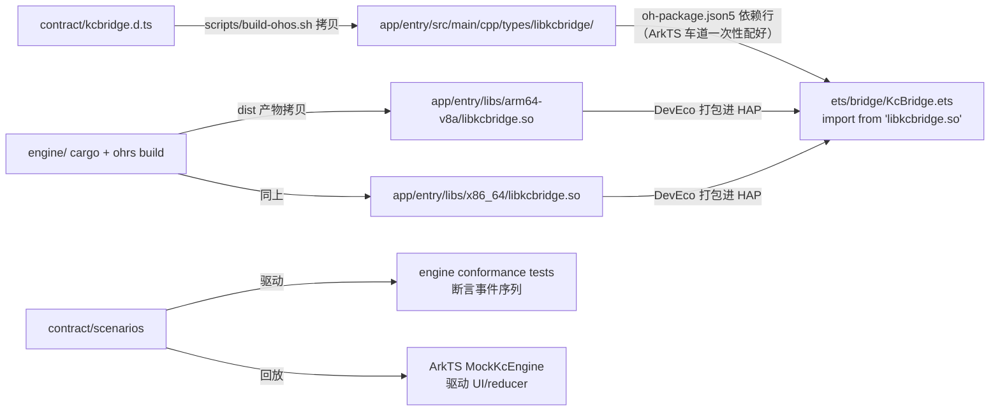

# 10 实现蓝图：仓库文件结构与对接机制（M0 施工总图）

> 定位：**按图施工的最后一层**——03 §7 的逐文件展开。每个文件一行职责 + 内容规格来源（哪份文档哪一节）+ 车道归属 + 骨架验证方式。M0 的产出物 = 本图全部文件就位（骨架级），此后每个任务卡都从本图挑文件开工。
> 纪律不变：骨架先行（07 §3：公开面 + 不变式 + 测试桩先行）；只写本车道文件（09 §2）；契约文件只能走 CCR（08 §9）。
> 编号说明：原 10/11 号已迁至 `docs/manual/`（人工手册）；本文件是新的 10 号（实现蓝图）。

## 1. 仓库总览（三区一桥）

```
oh-kdeconnect/
  contract/        双车道共管（08 §9）——唯一的共享真源
  engine/          Rust 车道（协议/TLS/SFTP/传输）
  app/             ArkTS 车道（DevEco 工程：UI/插件/持久化/lifecycle）
  tools/           protocol-peer（Go，自 docs/kdetestpeer-golang 迁入）+ arkts-logic-test.sh
  scripts/         build-ohos.sh（产物落位）+ check.sh（Rust 闸门）
  docs -> ../docs/kdeconnect-oh
```

车道所有权与 09 §2 完全一致；`app/entry/libs/` 与 `app/entry/src/main/cpp/types/` 是 **Rust 车道的产出落位区**（由脚本写入，ArkTS 车道只读）。

## 2. Rust 引擎目录（engine/）

```
engine/
  Cargo.toml                  workspace：5 crate 成员、workspace lints（09 §6）、依赖 pin（rustls/ring、russh/ring+rsa、rcgen/pem、serde、tokio、thiserror、sha2、hex）
  rust-toolchain.toml         锁 rustup 工具链版本
  rustfmt.toml / clippy.toml  格式与 lint 例外（allow-unwrap-in-tests）
  crates/
    kc-core/                  纯逻辑：无 IO、无 async、无全局状态，host 全量单测（06 §2.1）
      src/lib.rs                不变式清单 I1-I5 + 模块导出
      src/limits.rs             全部协议常量唯一来源（06 §2.1 模板：端口/限额/超时）
      src/error.rs              KcError + Disposition + 穷举分级（06 §2.2）
      src/packet.rs             Packet 信封 + serialize/parse + LineFramer（06 §2.6；flex 数值兼容 01 §2）
      src/types/mod.rs          body 类型注册表（P5：加包=加行）
      src/types/pair.rs         PairBody（06 §2.3 模板）
      src/types/ping.rs         —— 最简正例
      src/types/runcommand.rs   commandList 字符串套 JSON 双兼容（06 §2.3）
      src/types/share.rs        filename/text/url + payload 语义（01 §6）
      src/types/identity.rs     identity body + isValidIdentityPacket（01 §4 正则/过滤）
      src/pairing.rs            Pairing 状态机：转移表逐行（06 §2.4）
      src/sas.rs                verificationKey + 已知答案（06 §2.5：A82E8F8A/71A26CF5）
      src/device.rs             DeviceSnapshot + 能力协商（01 §4：双非空才更新/发送前校验）
      src/routing.rs            include_str! capabilities.v1.json + 一致性断言（08 §10）
      src/io.rs                 Clock/Rng trait（06 §2.6）
      tests/packet_tests.rs 等  table-driven + 协议违例负例
    kc-lan/                    IO 编排：不含协议判定（06 §2.1）
      src/lib.rs
      src/udp.rs                发现：单播/定向广播(P2b)/监听/限速（01 §2 步骤 1）
      src/tcp.rs                监听 1716-1764 顺序探测 + 连接器
      src/handshake.rs          明文 identity 交换 + target 校验 + v8 加密信道内二次交换（01 §2 步骤 2-5）
      src/tls.rs                rustls 双角色 + PeerTrust(TOFU/pin) + CN 校验（06 §2.7）
      src/link.rs               每链路读写 task + 单写者队列 + 断线自愈 300ms（01 §6）
      src/payload.rs            1739-1764 通道：监听/连回/流式/超时（08 §5）
    kc-sftp/                   russh 服务器（Phase 3）
      src/lib.rs
      src/server.rs             认证模型：host key=设备密钥/公钥白名单/一次性密码（01 §6）
      src/vfs.rs                沙箱根映射 + 路径规整（setSftpRoots 约束）
    kc-engine/                 编排层：host 可驱动的完整引擎（08 §7）
      src/lib.rs                Engine 公共 API（start/stop/全部命令，SyncSender 事件出口）
      src/config.rs             startConfig 解析+校验（08 §2：身份/已配对/能力一致性/allowedRoots）
      src/events.rs             15 个事件 enum + serde camelCase（08 §3 逐字段）
      src/actor.rs              EngineActor：设备表/配对/限额唯一写者（08 §7 并发模型）
      src/registry.rs           链路注册/替换（同 deviceId 证书必须相同，01 §2）
      src/transfer.rs           传输表 + transferOffer 自动接受时限（08 §5.3）
      src/bin/kc-cli.rs         host 命令行驱动：discover/pair/ping/send-file（09 §6 R3）
      tests/scenarios.rs        黄金场景驱动：加载 contract/scenarios（08 §8）
    kc-bridge/                 NAPI 薄壳：无业务状态（08 §7）
      src/lib.rs                #[napi] 19 个命令导出（08 §2 签名）+ panic 捕获
      src/session.rs            SessionHandle/单实例/调用序校验（08 §2 调用序规则）
      src/forward.rs            事件 sync mpsc → ThreadsafeFunction 回投（08 §3）
  fuzz/                        cargo-fuzz 目标：framer/sas/body（03 Phase 4，先建桩）
```

骨架验证：`./scripts/check.sh`（fmt + clippy -D warnings + test）全绿；`cargo check --target aarch64-unknown-linux-ohos` 通过（G2 host 预检）。

## 3. ArkTS 工程目录（app/，DevEco 标准结构）

```
app/
  AppScope/app.json5                       应用级配置（bundleName/version）
  build-profile.json5 / hvigorfile.ts / oh-package.json5（工程根）
  entry/
    build-profile.json5 / hvigorfile.ts
    oh-package.json5                       ★对接点1：依赖声明行（§4.2）
    src/main/
      module.json5                         权限4项 + backgroundModes:[multiDeviceConnection]（04 §3 全文）
      ets/
        entryability/EntryAbility.ets      启动时序（08 §6 图：loadIdentity→generateIdentity→start）
        logic/                             ★Kit-free 纯逻辑层（09 §5：零装饰器/零 Kit import，bun 可测）
          events.ets                         15 事件 decoder + 负例（08 §3 逐字段）
          commands.ets                       命令 payload 构造器（08 §2）
          store.ets                          DeviceStore + 纯函数 reducer（三态列表）
          caps.ets                           PluginDecl[] + capabilities 断言（08 §10 镜像）
          sanitize.ets                       文件名/输入规整（basename/拒../限长）
          events.test.ets 等                 bun 测试（tools/arkts-logic-test.sh 驱动）
        bridge/                            ★唯一 import native 的目录（06 §4.1）
          KcBridge.ets                       import 'libkcbridge.so' 封装 + KC_E<code> 解析（08 §4）
          KcException.ets                    错误语义化（04 §5 日志纪律）
          MockKcEngine.ets                   场景回放假引擎（08 §8：emit/expectCall）
          engineFactory.ets                  real/mock 切换（调试构建走 mock）
        store/DeviceViewModel.ets           @ObservedV2 视图模型（09 §5：单一事实源 reducer 更新）
        adapters/
          registry.ets                       adapter 注册表（P5：加插件=加行）
          PluginDecl.ets                     接口定义（06 §4.2）
          PingAdapter.ets …                  每插件一个（08 §10 顺序：ping→runcommand→…）
        ui/pages/Index.ets 等                @Entry 页面（设备列表/触控板/设置…，manual/02 A2）
        ui/components/PairDialog.ets 等      配对对话框（SAS 8 位码双端比对 UI）
        persist/
          IdentityStore.ets                  Asset(私钥 DER)+filesDir(证书)+Prefs(deviceId)（04 §3）
          PairedStore.ets                    RDB：paired_devices/plugin_enable（08 §5 唯一回写触发）
          Prefs.ets                          信任网络 SSID/自定义设备/下载目录
        lifecycle/
          BackgroundTask.ets                 MULTI_DEVICE_CONNECTION 申请/取消（02 §6）
          NetworkWatcher.ets                 connection 观察→networkChanged 推送（08 §2）
    src/main/cpp/types/libkcbridge/        ★对接点2：Rust 车道产物（脚本拷贝，ArkTS 只读）
      index.d.ts                             ← contract/kcbridge.d.ts 逐字拷贝
      package.json                           {"name":"libkcbridge.so","main":"index.d.ts"}
    src/main/resources/                     字符串/图标（UI 文案禁硬编码，走资源）
    src/test/（Hypium 本地测试桩）/ src/ohosTest/（真机用例）
  entry/libs/arm64-v8a/libkcbridge.so      ★对接点3：Rust 车道产物（真机）
  entry/libs/x86_64/libkcbridge.so         ★对接点3（模拟器）
```

骨架验证：`hvigorw assembleHap` 零 error；`tools/arkts-logic-test.sh` 全绿（logic 层先行，不依赖 .so）。

## 4. 对接部分（三点的流水线与运行时）

### 4.1 契约源（contract/，双车道共管）

```
contract/
  kcbridge.d.ts          19 命令签名（08 §2 逐字）——两侧实现的共同目标
  errors.v1.json         23 错误码机读表（08 §4）——Rust enum 测试 + ArkTS KcException 映射各断言一次
  capabilities.v1.json   14 插件收发类型（08 §10）——Rust include_str! + ArkTS caps.ets 各断言一次
  scenarios/*.json       黄金场景（08 §8 起步集：pairing-in/share-in/share-out/ping…）
  CCR-*.md               变更记录（08 §9）
```

### 4.2 产物流水线（谁产出、怎么落位）



`scripts/build-ohos.sh`（Rust 车道所有）做的事，按序：`ohrs build`（双 arch）→ 校验 d.ts 与 contract 逐字节一致（防漂移）→ 拷 `.so`×2 与 types 两件 → 打印落位清单。失败即退出非零，CI 挂闸。

依赖声明行（ArkTS 车道一次性写入 `entry/oh-package.json5`）：

```json5
"dependencies": {
  "libkcbridge.so": "file:./src/main/cpp/types/libkcbridge"
}
```

### 4.3 运行时对接序列（首次集成 = 关卡 I3）

```
EntryAbility.onCreate
  → bridge.contractVersion() ≠ 常量 → 拒启（E109）
  → persist.loadIdentity()                     首次: engine.generateIdentity(name) → 存 Asset/filesDir/Prefs
  → engineFactory()                            调试构建可切 Mock
  → setOnEvent(cb) → start(configJson)
  → 事件: engineStarted{version,tcpPort} → lifecycle 申请长时任务
  → 后续一切功能 = sendPacket/sendFile 命令 + 事件 reducer（manual/02 Part 3 的机制不再变化）
```

### 4.4 版本握手与漂移防线

三道闸（任何一道失败都不许进下一步）：① `contractVersion()` 运行时比对；② build-ohos.sh 的 d.ts 逐字节校验；③ 两侧对 errors/capabilities/scenarios 的 diff 断言测试。契约变更只走 CCR（08 §9），改四处（d.ts/errors/capabilities/场景）一次提交。

## 5. 文件 × 规格 × 车道 × 验证（追溯总表）

| 文件/目录 | 内容规格 | 车道 | 骨架验证 |
|---|---|---|---|
| engine/Cargo.toml + 3 配置 | 09 §6 M0（workspace lints/依赖 pin） | Rust | check.sh 绿 |
| kc-core 12 文件 | 06 §2.1-2.6 逐节模板 | Rust | cargo test -p kc-core |
| kc-lan 7 文件 | 01 §2/P2b + 06 §2.7 | Rust | cargo check + 场景注入 |
| kc-sftp 3 文件 | 01 §6（Phase 3 才填肉） | Rust | 骨架编译过 |
| kc-engine 7 文件 | 08 §2/§3/§5/§7 | Rust | 场景驱动空引擎第一红→逐绿 |
| kc-bridge 3 文件 | 08 §2 + 06 §3.1 | Rust | 真机 load（I3） |
| contract/ 5 类工件 | 08 全文 | 共管(CCR) | 两侧 diff 断言 |
| app entry ets 六层 | 09 §5 + 06 §4 + 08 §3 | ArkTS | assembleHap + bun |
| app types/libs 落位 | §4.2 流水线 | Rust 产/ArkTS 用 | build-ohos.sh 清单 |
| oh-package 依赖行 | §4.2 | ArkTS | DevEco Sync |
| tools/protocol-peer | docs/kdetestpeer-golang 迁入 | Rust | go test + 自演 |
| tools/arkts-logic-test.sh | 09 §5 | ArkTS | bun 全绿 |
| scripts/check.sh / build-ohos.sh | 09 §6/§9 | Rust | 全链跑通 |

## 6. M0 落位序列（按图生成骨架的实际动作）

1. `mkdir oh-kdeconnect/{contract,engine,app,tools,scripts}`；contract/ 五类工件从 08 抄录落位；
2. Rust：`cargo new --lib` ×5 + 本图文件逐个 `touch` + limits/error/packet 填入 06 模板 → check.sh 绿；
3. ArkTS：DevEco 向导建 Empty Ability 工程入 app/ → 建 logic/bridge/adapters/ui/store/persist/lifecycle 七目录与空文件 → assembleHap 零 error；
4. 对接：写 build-ohos.sh（此时可先只含 d.ts 拷贝+校验段）+ oh-package 依赖行（暂无 .so，用 Mock 开发，不阻塞）；
5. `tools/protocol-peer` 自 `docs/kdetestpeer-golang/` 迁入（删 README 的"未来归属"注记）；
6. 逐关卡开工：I1（契约冻结评审）→ I2（场景双绿）→ …

此图与 03 §7（工程结构）、07 §4（模块顺序）、09 §6/§8（任务队列）为同一结构的不同粒度视图；冲突时以本图（最细粒度）+ 08（接口）为准。
